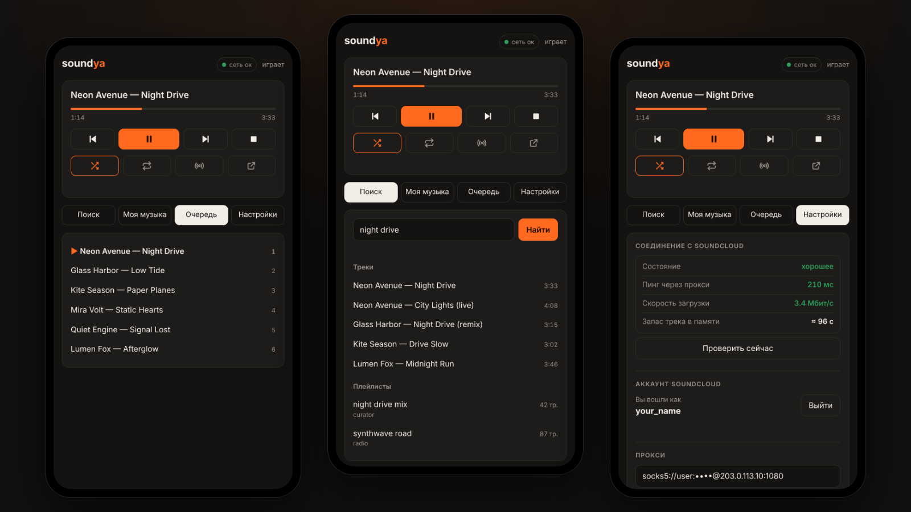
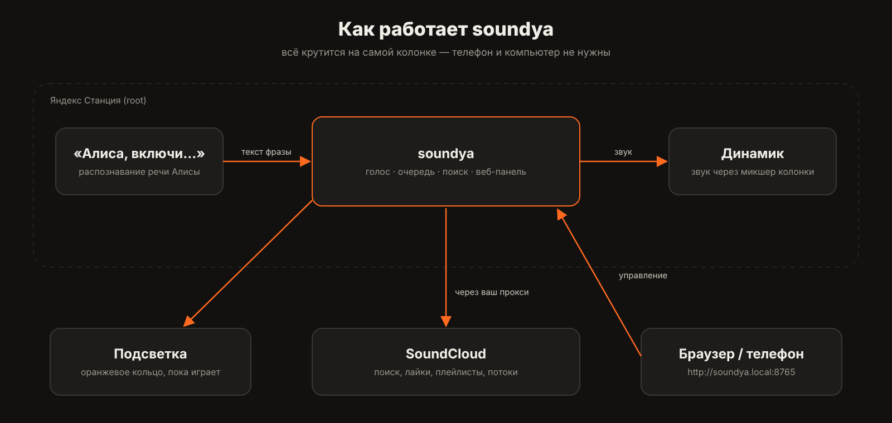
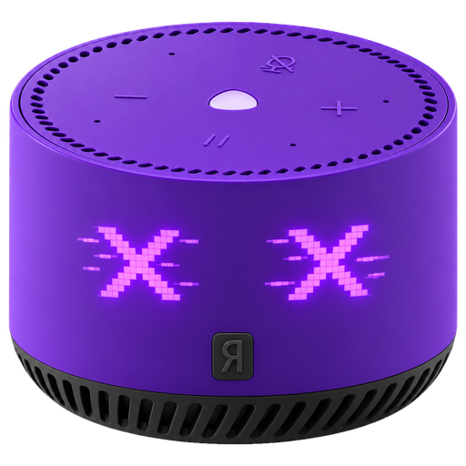

<p align="center">
  
</p>

<h1 align="center">soundya</h1>

<p align="center">
  <b>SoundCloud на Яндекс Станции — голосом Алисы, без телефона и компьютера</b>
</p>

<p align="center">
  <a href="https://www.donationalerts.com/r/rodyatotu"></a>
  <a href="#поддержать-проект"></a>
</p>

<p align="center">
  
  
  
  
</p>

---

**soundya** — небольшая программа, которая живёт прямо на рутованной Яндекс Станции и играет музыку из SoundCloud. Говорите «Алиса, включи Bonobo» — и колонка сама находит трек и включает его. Управлять можно и с телефона: у колонки появляется своя веб-страница.

<p align="center">
  
</p>

## Что умеет

<p align="center"></p>


- 🎙 **Голос.** «Алиса, включи …», «пауза», «дальше», «перемешай», «включи мои лайки», «включи рекомендации», «что сейчас играет» — Алиса не уходит в Яндекс Музыку.
- 👤 **Ваш аккаунт SoundCloud.** Лайки, свои и сохранённые плейлисты, подборки SoundCloud.
- ✨ **Рекомендации.** «Волна» из треков, похожих на ваши лайки. Подбирается заранее, включается сразу.
- 📱 **Веб-панель** по адресу `http://soundya.local:8765`: плеер с перемоткой (нажмите на полосу), поиск, очередь, настройки.
- 🔀 Перемешивание, повтор, «похожее», автопродолжение похожими треками в конце очереди.
- 🌐 **Прокси** (SOCKS5/HTTP) для мест, где SoundCloud недоступен, и **индикатор соединения** — видно, когда всё тормозит из-за сети.
- 🟠 **Оранжевая подсветка** кольца: плавно мигает, пока колонка загружает из SoundCloud, горит, пока играет музыка, и тускло светится на паузе.
- 📡 **AirPlay:** колонка появляется в списке AirPlay на iPhone, iPad и Mac — играйте на неё что угодно с телефона.
- 🖥 **Компьютер голосом** (Windows): включить, выключить, усыпить, открыть или закрыть программу.
- 💪 **Устойчивость к плохой сети:** трек скачивается заранее, при обрыве дозагружается и продолжается с того же места.

## Голосовые команды

<p align="center"></p>


| Сказать | Что произойдёт |
|---|---|
| «Алиса, включи **Bonobo**» / «включи песню …» | поиск и воспроизведение |
| «Алиса, включи **саундклауд**» | продолжить или включить ваши лайки |
| «включи **мои лайки**» / «включи **мой плейлист** осень» | ваша музыка (нужен вход) |
| «включи **рекомендации**» / «включи что-нибудь новое» | подборка по вашему вкусу |
| «включи плейлист …» | сначала среди ваших, потом в SoundCloud |
| «пауза», «стоп», «продолжи», «дальше», «назад» | управление |
| «**перемешай**» / «играй по порядку» | перемешивание |
| «поставь **на повтор**» / «выключи повтор» / «включи заново» | повтор |
| «включи **похожее**» | треки, похожие на текущий |
| «**что сейчас играет**?» | Алиса скажет название |
| «**перемотай на 30 секунд**» / «перемотай вперёд на минуту» / «отмотай назад на 10 секунд» | перемотка |
| кнопка **▶‖** на колонке | пауза / продолжить SoundCloud |
| «включи **компьютер**» / «выключи компьютер» / «усыпи компьютер» | [компьютер с Windows](#компьютер-голосом-windows) |
| «**открой телеграм на компьютере**» / «закрой хром на компе» | программы на компьютере |

Команды управления (пауза, дальше и т. п.) soundya перехватывает только пока сам играет — в остальное время Алиса работает как обычно. В настройках можно включить режим «только по слову саундклауд»: тогда «включи Bonobo» остаётся Алисе, а «включи Bonobo **в саундклауде**» — soundya.

## Как это работает

<p align="center">
  
</p>

soundya подключается к локальному интерфейсу Алисы на самой колонке (`127.0.0.1:9875`), получает распознанный текст фразы, отменяет ответ Алисы и сам ищет и проигрывает музыку. Звук идёт через штатный микшер колонки, поэтому Алиса может говорить поверх музыки — музыка в это время приглушается.

## Что нужно

- **Яндекс Станция Лайт** (1-го поколения). Проверено на прошивке `0.369.1.46`. Мини 1 по устройству похожа, но не проверялась.
- **Root-доступ по ADB** и **отключённые обновления** (см. шаг 1).
- Компьютер с `adb` — только для установки. Дальше колонка работает сама.
- Если SoundCloud у вас недоступен — **SOCKS5- или HTTP-прокси**.

## Установка

### 1. Root и отключение обновлений

> [!WARNING]
> Сброс колонки стирает все её настройки, колонку придётся заново привязать к аккаунту. Ошибка в процессе может сломать колонку. Всё делаете на свой риск.

> [!IMPORTANT]
> DNS-метод работает **только на прошивках до обновления 20–21 октября 2026**. Проверено на Станции Лайт 1 с прошивкой `0.369.1.46` (сборка от 13 октября 2026). Сброс до заводских настроек (шаг 1.1) откатывает колонку на заводскую прошивку, поэтому важна версия, которая стоит **после сброса**: её видно в приложении «Дом с Алисой» в настройках колонки. Актуальный статус смотрите на [hackalice.me](https://hackalice.me/start/root/).

Гайд пересказывает [hackalice.me — шаг 1](https://hackalice.me/start/root/) и [шаг 2](https://hackalice.me/start/ssh/). Если что-то не сходится, верьте им: там гайд обновляют.

**Что понадобится:**
- роутер, в котором можно поменять DNS (Keenetic, ASUS, TP-Link, OpenWrt, MikroTik). Если нельзя, подойдёт второй Android-телефон в режиме точки доступа с приложением DNS Changer;
- компьютер в той же сети с `adb`: на Mac `brew install android-platform-tools`, на Windows и Linux — [Platform Tools](https://developer.android.com/tools/releases/platform-tools);
- телефон с приложением «Дом с Алисой».

#### 1.1. Сбросьте колонку

Выньте кабель питания. Зажмите кнопку выключения микрофона и, не отпуская её, вставьте кабель обратно. Держите 10–15 секунд, пока кольцо не замигает и Алиса не скажет про сброс.

Сброс стирает все настройки и **откатывает колонку на заводскую прошивку**: всё, что она успела скачать с обновлениями, пропадает.

#### 1.2. Начните привязку и остановитесь на Wi-Fi

На телефоне включите Bluetooth и геолокацию. В «Доме с Алисой»: «+» → «Устройство с Алисой» → дойдите до экрана с паролем от Wi-Fi.

**Пока не нажимайте «Подключиться».** Если поменять DNS раньше этого экрана, привязка сломается.

#### 1.3. Поменяйте DNS в роутере

Поставьте первым DNS-сервером для домашней сети (DHCP) адрес `179.254.167.126`, второй оставьте пустым.

- **Keenetic:** «Сетевые правила» → «Домашняя сеть» → «Параметры IP и DHCP» → DNS 1 → «Сохранить».
- **ASUS:** «ЛВС» → «DHCP-сервер» → «DNS-сервер 1».
- **TP-Link:** «Дополнительные настройки» → «Сеть» → «DHCP-сервер» → «Основной DNS».
- **OpenWrt** (меняет DNS только для нужных доменов, остальная сеть не затронута — лучший вариант):
  ```sh
  uci add_list dhcp.@dnsmasq[0].server='/quasar.yandex.net/179.254.167.126'
  uci add_list dhcp.@dnsmasq[0].server='/quasar.yandex.ru/179.254.167.126'
  uci add_list dhcp.@dnsmasq[0].server='/scbh.yandex.net/179.254.167.126'
  uci commit dhcp && /etc/init.d/dnsmasq reload
  ```

DNS нужно менять именно для **домашней сети (DHCP)**. Настройка DNS для интернет-подключения (WAN) не поможет.

`179.254.167.126` — сервер сообщества, не ваш. Если не хотите от него зависеть, запустите такой же стенд у себя на Mac ([lite-kit](https://github.com/krevetkqqq/lite-kit), инструкция в его README) и укажите в роутере IP вашего компьютера.

#### 1.4. Подключите колонку

Вернитесь в приложение и нажмите «Подключиться». Колонка подключится к Wi-Fi, помигает и издаст звук готовности.

#### 1.5. Зайдите по ADB

Найдите IP колонки в списке устройств роутера и выполните на компьютере:
```sh
adb connect <IP-колонки>:5555
adb shell id
```
Если в ответе есть `uid=0(root)`, root получен.

#### 1.6. Отключите обновления — сразу, пока DNS не вернули

Иначе Яндекс пришлёт новую прошивку, и root пропадёт. Скрипт берём из [yandex-station-extended](https://github.com/Marker284/yandex-station-extended):
```sh
git clone https://github.com/Marker284/yandex-station-extended && cd yandex-station-extended
adb shell 'mkdir -p /data/quasar && touch /data/quasar/activate_adb_quasmodrom /data/quasar/activate_network_adb && chattr +i /data/quasar/activate_adb_quasmodrom /data/quasar/activate_network_adb'
adb shell mkdir -p /data/opt
adb push contrib/yandex-noupdate.sh /data/opt/yandex-noupdate.sh
adb shell sh /data/opt/yandex-noupdate.sh
```
Первая команда `adb shell` оставляет ADB по сети включённым после перезагрузки. Скрипт `yandex-noupdate.sh` выключает обновления.

#### 1.7. Верните DNS и перезагрузите колонку

Уберите `179.254.167.126` из настроек роутера и верните как было. Для OpenWrt:
```sh
uci -q del_list dhcp.@dnsmasq[0].server='/quasar.yandex.net/179.254.167.126'
uci -q del_list dhcp.@dnsmasq[0].server='/quasar.yandex.ru/179.254.167.126'
uci -q del_list dhcp.@dnsmasq[0].server='/scbh.yandex.net/179.254.167.126'
uci commit dhcp && /etc/init.d/dnsmasq reload
```
Затем:
```sh
adb shell reboot
# подождите минуту
adb connect <IP-колонки>:5555
adb shell sh /data/opt/yandex-noupdate.sh status
```
В ответе должно быть: `updatesd убран`, `заглушён`, `подменён`. Root остаётся и с обычным DNS.

<details>
<summary><b>Если на каком-то шаге не получилось</b></summary>

- **«Не удалось подключиться к Wi-Fi» в приложении** — DNS поменяли слишком рано. Уберите его, сбросьте колонку и начните с 1.1.
- **`adb connect` пишет `refused` на порт 5555** — выключите в роутере фильтрацию DNS (Яндекс.DNS, AdGuard) и передёрните питание колонки.
- **`unable to connect`** — компьютер и колонка должны быть в одной сети. Гостевая сеть с изоляцией клиентов не подойдёт.
</details>

### 2. Закрепите IP колонки в роутере

Чтобы колонка не меняла адрес после перезагрузки, закрепите его за ней в DHCP роутера:

- **TP-Link:** Advanced → Network → DHCP Server → Address Reservation → Add
- **Keenetic:** Список устройств → колонка → «Постоянный IP-адрес»
- **ASUS:** ЛВС → DHCP-сервер → «Список назначенных вручную IP-адресов»

Веб-панель и так доступна по имени **`soundya.local`** (mDNS), но закреплённый IP пригодится для `adb` и для устройств, которые не понимают `.local`.

### 3. Получите soundya

**Готовая сборка:** скачайте `soundya-armv7.tar` со страницы [Releases](../../releases).

**Или соберите сами** (macOS или Linux):
```sh
curl https://sh.rustup.rs -sSf | sh -s -- -y && source ~/.cargo/env
rustup target add armv7-unknown-linux-gnueabihf
brew install zig cargo-zigbuild          # на Linux: pip install ziglang && cargo install cargo-zigbuild
git clone https://github.com/rodyatotu/soundya && cd soundya
sh scripts/build-mac.sh                  # → dist/soundya-armv7.tar
```

### 4. Установите на колонку

**С Windows:** скачайте проект (зелёная кнопка **Code** → **Download ZIP**), распакуйте и дважды щёлкните **`install-windows.cmd`**. Он сам скачает adb, найдёт колонку в сети, возьмёт готовую сборку из [Releases](../../releases), установит её и откроет веб-панель.

**С Mac или Linux**, из папки проекта:
```sh
sh scripts/deploy.sh <IP-колонки>
```

Или вручную, если скачали готовую сборку:
```sh
adb connect <IP-колонки>:5555
adb push soundya-armv7.tar /tmp/
adb shell "cd /tmp && tar -xf soundya-armv7.tar && sh /tmp/soundya/install.sh"
```

Установщик кладёт всё в `/data/opt/soundya`, добавляет автозапуск и команду `soundya`. Настройки при обновлении сохраняются.

### 5. Настройте

<p align="center"></p>


Откройте **http://soundya.local:8765** (или `http://<IP-колонки>:8765`) → **Настройки**:

1. **Прокси** — если SoundCloud у вас открывается только через него. Кнопка «Проверить прокси» покажет, работает ли он.
2. **Аккаунт SoundCloud** — для лайков, плейлистов и рекомендаций. SoundCloud не даёт сторонним приложениям вход по паролю, поэтому нужен токен из браузера: войдите на soundcloud.com → инструменты разработчика (Cmd+Option+I / F12) → Application → Cookies → `https://soundcloud.com` → значение `oauth_token`. Токен — как пароль: никому его не отправляйте.

Всё. Скажите: **«Алиса, включи рекомендации»**.

## AirPlay

Колонка видна в списке AirPlay на iPhone, iPad и Mac как **«Яндекс Станция»**: Пункт управления → значок AirPlay, или кнопка AirPlay в Apple Music, Spotify, YouTube и других приложениях. Звук идёт с телефона на колонку по домашнему Wi-Fi, громкость меняется кнопками телефона.

- Пока играет AirPlay, SoundCloud стоит на паузе, а кольцо горит оранжевым. Скажете «Алиса, включи …» — SoundCloud заберёт колонку обратно, а AirPlay отключится.
- Когда Алиса слушает или отвечает, музыка с AirPlay становится тише, как и SoundCloud.
- Название меняется на странице колонки: «Настройки» → «AirPlay». Там же AirPlay выключается.
- Ставить на паузу и переключать треки нужно на телефоне: Алиса командует только SoundCloud.

Это классический AirPlay (как у колонок с AirPort Express): он работает со всеми iPhone и Mac, но колонку нельзя объединить в группу с HomePod. Если колонка не появляется в списке, телефон и колонка должны быть в одной сети без изоляции клиентов, а в роутере не должен быть выключен multicast (mDNS).

## Компьютер голосом (Windows)

Колонка может управлять компьютером с Windows в той же домашней сети:

| Сказать | Что произойдёт |
|---|---|
| «Алиса, включи компьютер» | включит компьютер по сети (нужен кабель, см. ниже) |
| «выключи компьютер» / «перезагрузи компьютер» | выключит / перезагрузит через 3 секунды |
| «усыпи компьютер» / «переведи компьютер в спящий режим» | спящий режим |
| «заблокируй компьютер» | экран блокировки |
| «открой **телеграм**» / «открой стим на компьютере» / «запусти на компе дискорд» | откроет программу |
| «закрой **хром**» / «выключи дискорд на компьютере» | закроет программу |
| «открой **ютуб в профиле работа**» / «открой в браузере профиль учёба» | Chrome с нужным профилем и сайтом |
| «**найди в гугле** как приготовить плов» / «загугли курс доллара» | поиск в Google |
| «**найди на ютубе** как установить виндоус» | поиск на YouTube |
| «**запиши** купить молоко» / «открой блокнот и запиши …» | заметка: отдельный файл в «Документы\Заметки» |
| «**допиши в блокнот** купить хлеб» | строка в последнюю заметку |
| «**создай документ** отчёт с текстом …» | документ Word с текстом |
| «**напиши маме в телеграм** привет» / «отправь саше сообщение …» | сообщение в Telegram (контакты задаются в настройках) |
| «**подключи впн**» / «отключи впн» | открывает / закрывает приложение VPN |
| «**создай папку** проекты на рабочем столе» | новая папка |

Программы ищутся по ярлыкам в меню «Пуск», на рабочем столе и в библиотеке Steam, так что подойдёт почти всё установленное. «Открой …», «запиши …», «найди в гугле …» работают и без слов «на компьютере». Русские названия популярных программ (телеграм, хром, стим, дискорд, ворд, блокнот…) уже знакомы. Свои названия добавляются в `%LOCALAPPDATA%\soundya-pc\config.json`:
```json
"apps": { "моя игра": "C:\\Games\\Game\\game.exe", "почта": "Outlook" },
"sites": { "джира": "https://jira.example.com" }
```

### Установка на компьютер

1. На компьютере откройте эту страницу → зелёная кнопка **Code** → **Download ZIP**. Распакуйте архив: правой кнопкой → «Извлечь всё».
2. В распакованной папке откройте `pc` и дважды щёлкните **`install.cmd`**. Windows спросит разрешение администратора — согласитесь. Если появится «Windows защитила ваш компьютер» — «Подробнее» → «Выполнить в любом случае».
3. Установщик покажет **адрес компьютера**, **ключ** и **MAC-адрес**. Впишите их на `http://soundya.local:8765` → «Настройки» → «Компьютер» и нажмите «Проверить связь». Должно появиться «Компьютер … на связи».
4. Закрепите за компьютером IP в роутере, как для колонки (шаг 2 установки), иначе адрес однажды сменится.

Программа запускается сама при входе в Windows. Возле часов появляется оранжевый **значок колонки** с точкой: зелёная — колонка на связи (при наведении видна задержка в мс), красная — колонка не отвечает, серая — программа не запущена. По правой кнопке на значке: что играет и пауза / следующий трек, последняя команда, **данные для колонки** (IP, ключ, MAC — с копированием), проверка связи, **перезапуск**, лог и настройки. Если колонка не находится сама, впишите её адрес в `config.json`: `"speaker": "192.168.0.112"`.

Программа принимает команды только из домашней сети и только с правильным ключом, открывать умеет только программы, а не произвольные команды. Удалить — `pc\uninstall.cmd`.

### Чтобы «включи компьютер» работало

Включение по сети (Wake-on-LAN) работает, только если компьютер подключён к роутеру **кабелем**: по Wi-Fi компьютер в выключенном состоянии сигнал не слышит.

1. **Установщик уже** включил пробуждение в настройках сетевой карты и выключил «быстрый запуск» Windows (с ним большинство компьютеров после «Завершения работы» по сети не включаются).
2. **В BIOS/UEFI** (при включении жмите Del или F2) найдите и включите пункт с названием вроде *Wake on LAN*, *Power On By PCI-E*, *Resume by LAN* или *Network Stack*. Если есть *ErP Ready* или *Deep Sleep* — выключите.
3. Проверьте: выключите компьютер через «Пуск» и скажите «Алиса, включи компьютер».

Если не включается из выключенного состояния, обычно помогает «усыпить» вместо «выключить»: из сна компьютер просыпается по сети почти всегда.

## Настройки на колонке

Файл `/data/opt/soundya/soundya.env` (после правки — `/etc/init.d/S99soundya restart`):

| Переменная | По умолчанию | Что делает |
|---|---|---|
| `SOUNDYA_WEB_PORT` | `8765` | порт веб-панели, `0` — выключить |
| `SOUNDYA_NAME` | `soundya` | имя в сети: `http://<имя>.local:8765` |
| `SOUNDYA_DEVICE` | `default` | ALSA-устройство вывода |
| `SOUNDYA_DNS` | — | свои DNS-серверы, если системный DNS колонки не работает |

Прокси, вход, «только по слову саундклауд» и подсветка настраиваются на странице и хранятся в `/data/opt/soundya/config.json`.

## Команды на колонке

```sh
soundya play <запрос | ссылка>   soundya playlist <запрос>   soundya likes   soundya recs
soundya pause | resume | toggle | next | prev | stop
soundya shuffle on|off           soundya repeat on|off       soundya similar
soundya status | queue            soundya pc wake|sleep|shutdown|open <программа>
/etc/init.d/S99soundya start | stop | restart
```
Лог: `/tmp/soundya.log`.

## Если что-то не так

<details>
<summary><b>Алиса отвечает «нужна подписка на Яндекс Музыку»</b></summary>

Значит, фразу забрала Алиса. Посмотрите в логе строки `voice: …`: там видно, что soundya услышал и почему отдал Алисе. Команды управления («дальше», «пауза») перехватываются, только пока играет SoundCloud.
</details>

<details>
<summary><b>Долго грузится, Алиса долго «думает»</b></summary>

Откройте «Настройки» → «Соединение с SoundCloud». Если пинг больше ~500 мс или скорость меньше ~600 кбит/с — тормозит прокси или сеть. Попробуйте другой прокси.
</details>

<details>
<summary><b>Трек «играет», но звука нет (время стоит на 0:00)</b></summary>

`adb shell 'grep -E "^(player|alsa)" /tmp/soundya.log | tail'`. Если звуковая карта не запускается — перезагрузите колонку (`adb shell reboot`): это сбрасывает общий звуковой микшер.
</details>

<details>
<summary><b>Колонка зависла: не отвечает ни на голос, ни на кнопки</b></summary>

Иногда звуковая карта колонки застревает, и тогда не может играть никто, даже сама Алиса. soundya следит за этим: через полторы минуты перезапускает звуковой сервис Алисы, а если не помогло — перезагружает колонку (не чаще раза в час). Если колонка всё равно висит — выньте питание на 10 секунд.

Что было перед зависанием, видно и после выключения питания:
```sh
adb shell 'cat /data/opt/soundya/guard.log; tail -40 /data/opt/soundya/previous.log'
```
</details>

<details>
<summary><b>Страница по адресу soundya.local не открывается</b></summary>

Откройте по IP колонки (`http://<IP>:8765`). Некоторые старые Android-устройства не понимают адреса `.local`.
</details>

<details>
<summary><b>Почему нельзя ставить лайки и добавлять в плейлисты из soundya</b></summary>

SoundCloud отвечает на такие запросы капчей своей антибот-защиты — изменения он разрешает только из браузера или приложения. Кнопка «↗» в плеере открывает текущий трек на SoundCloud, где лайк ставится в одно нажатие. Читать лайки и плейлисты это не мешает.
</details>

## Ограничения

- Треки Go+ без подписки и часть лицензированных треков SoundCloud отдаёт только 30-секундным превью — такие пропускаются.
- Используется неофициальный API сайта SoundCloud: если они его поменяют, понадобится обновление.
- Проверено только на Станции Лайт 1-го поколения.
- AirPlay — только классический (AirPlay 1): без мультирума с HomePod и без паузы голосом.

## Благодарности

- [**spotiya**](https://github.com/klockky/spotiya) (MIT) — протокол локального интерфейса Алисы, на котором держится голосовое управление.
- [**yandex-station-extended**](https://github.com/Marker284/yandex-station-extended) и [**hackalice.me**](https://hackalice.me) — гайды по руту, скрипт отключения обновлений, описание озвучки через Алису.
- [**lite-kit**](https://github.com/krevetkqqq/lite-kit) — стенд для получения root.
- [symphonia](https://github.com/pdeljanov/Symphonia), [ureq](https://github.com/algesten/ureq), [serde](https://serde.rs).
- [**shairport-sync**](https://github.com/mikebrady/shairport-sync) — приёмник AirPlay. Собран статически с [musl](https://musl.libc.org), [Mbed TLS](https://github.com/Mbed-TLS/mbedtls) (Apache-2.0), [libconfig](https://github.com/hyperrealm/libconfig) (LGPL-2.1) и [popt](https://github.com/rpm-software-management/popt) скриптом `scripts/build-shairport.sh`: исходники и точные версии — там, пересобрать можно им же.

## Важно

soundya — неофициальный проект и никак не связан с Яндексом и SoundCloud. Root-доступ и изменение прошивки — на ваш страх и риск: гарантию на колонку это может лишить. Пользуйтесь SoundCloud в рамках его правил.

## Поддержать проект

Если soundya вам пригодился — можно сказать спасибо:

<p align="center">
  <a href="https://www.donationalerts.com/r/rodyatotu"></a>
</p>

<p align="center">
  <picture>
    <source media="(prefers-color-scheme: dark)" srcset="docs/usdt-qr-dark.png">
    
  </picture>
</p>

<h3 align="center">USDT · TRC-20</h3>
<p align="center"><code>TSEJPa8FefWd8u8mo4USu8muSJr7589gWg</code><br><sub>Только сеть Tron (TRC-20). Перевод в другой сети потеряется.</sub></p>

## Лицензия

[MIT](LICENSE)

<p align="center"></p>
