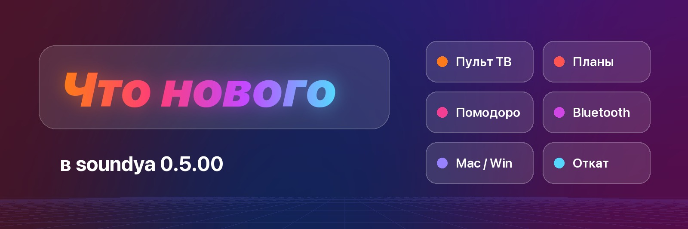

  

<h2 align="center">soundya 0.5.00 — нас больше ста 🧡</h2>

<b>Больше 100 колонок уже играют с soundya.</b> 
Спасибо каждому, кто поставил, написал отзыв, прислал баг или просто рассказал другу. 
Это самое большое обновление за всё время — и сделано оно для вас.

---

## ⬇️ Скачать

| | Файл | Как |
|---|---|---|
| 🍏 **Mac** | `soundya.dmg` | открыть → перетащить soundya в «Программы» → запустить |
| 🪟 **Windows** | `soundya-setup-windows.exe` | двойной клик |
| 🔊 **Колонка** (вручную) | `soundya-armv7.tar` | для `scripts/deploy.sh` и YAM |

Уже стоит soundya? Нажмите **«Обновить»** в приложении или на странице колонки: настройки, вход в SoundCloud и ключи сохранятся. Перед обновлением колонка сама сохранит копию — если новая версия не запустится, вернётся прежняя.

---

### 📺 Пульт для телевизора
- **«Алиса, пульт»** — и дальше просто «вправо», «ок», «назад», «пауза», «громче». Понимает и «пульт ду», «открой пульт», «пульт телевизора».
- Новая вкладка **«Пульт»** на панели — большой пульт с телефона (включается в «Устройства» → «Телевизор»).
- Кнопки срабатывают быстрее: колонка держит соединение с телевизором, а не подключается заново на каждое нажатие.
- «Подключись к впн», «открой историю в смарт тьюб», «включи последнее видео», сценарии из нескольких шагов.

### 🗓 Планы, задачи и Google
- **Google Календарь и Google Задачи в обе стороны**: «Алиса, какие планы на сегодня», «добавь задачу сдать отчёт завтра до 18:00», «добавь в календарь встречу в 15 на 2 часа».
- Дедлайны с вопросом **«Сделали?»** — «да», «нет», «через 2 часа».
- Утренняя сводка, предупреждение о сроке заранее, профиль «Работа» с рабочими часами.
- Даты по-человечески: «12 марта», «через неделю в 10», «до пятницы», «в 7 часов вечера».
- Вкладка **«Планы»** на панели.

### ⏱ Помодоро и таймеры
- «Алиса, запусти помодоро» — работа, перерыв, круги; таймер на кольце и экране-часах.

### 💻 Компьютер — теперь и Mac
- **Mac голосом**: сон, блокировка, выключение, открыть/закрыть программу, поиск в Google и YouTube, загрузка процессора.
- Подключить компьютер — одна кнопка в приложении: **«Только подключить этот компьютер»**. Ссылки на скачивание — прямо на странице колонки.
- Команды подписываются (HMAC), ключ больше не ходит по сети открытым текстом.
- Музыка сама становится тише, пока вы на звонке.

### 🎧 Bluetooth, AirPlay, звук
- Вывод звука на **Bluetooth-наушники и колонки** (где прошивка это умеет — есть проверка возможностей).
- Эквалайзер больше не делает тише всё остальное.
- **«Слушать здесь»** — музыка колонки в браузере на телефоне или компьютере, с того же места.
- Громкость голоса Алисы отдельно от музыки.

### 🎨 Новая панель
- Стекло в духе Liquid Glass, живой фон, главная со сводкой и устройствами.
- **Виджеты главной** включаются и перетаскиваются пальцем — порядок запоминается на колонке.
- Обложки грузятся быстро, погода работает и там, где Open-Meteo недоступен.
- Новые эффекты Ambilight: волна, радуга, дыхание, бегущий огонь — под музыку.
- Новая минималистичная иконка 🟧

### 🍏 Приложение для Mac и установщик для Windows
- Один файл, внутри — всё: найти колонку, выбрать функции, установить с прогрессом. Отдельный adb не нужен.
- Виджет для Mac (macOS 14+): что играет, пауза, громкость.
- Находит колонку и при включённом VPN.

### 🛡 Надёжность и защита
- **Безопасное обновление**: копия программы и настроек, проверка контрольных сумм, автоматический откат.
- Настройки не портятся при выдёргивании питания.
- **PIN для панели** и выключатель **ADB по сети** — в «Настройки» → «Колонка» → «Защита», если в вашем Wi-Fi бывают чужие.
- Кнопка **▶‖** на колонке больше не включает Яндекс Музыку, когда музыка по умолчанию — SoundCloud.
- Десятки исправлений после большого ревью кода: колонка больше не падает от кириллицы в настройках, веб-сервер не забивает память, задачи Google не закрываются из-за сбоя сети.

### 🐞 Сообщить об ошибке
- Кнопка в каждом разделе: журнал, диагностика, скриншот. Перед отправкой видно всё, что уйдёт, — токены, ключи и телефоны вырезаются.

---

  <b>💬 Сообщество в Telegram:</b> <a href="https://t.me/+t9kgMTEpnQM3N2Vk">t.me/+t9kgMTEpnQM3N2Vk</a> 
  Нашли баг — кнопка «Сообщить об ошибке» на странице колонки. Нравится — ⭐ репозиторию и расскажите другу.

Часть функций зависит от модели и прошивки колонки (Bluetooth, экран-часы, AirPlay 2) и проверена не на всех моделях. Если что-то не работает — напишите, починим.
